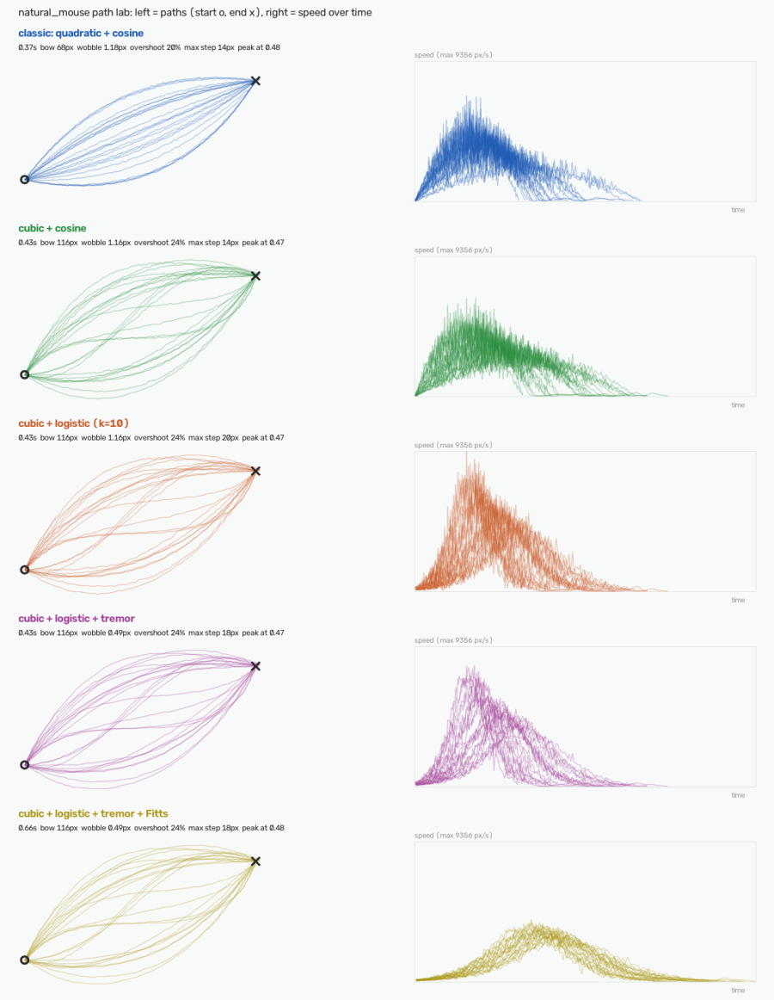

# natural_mouse

A Windows screen-automation library: find a UI element on screen (by
image or colour), then move the cursor to it and click along a
human-like path instead of an instant teleport-and-click:

- **curved**: quadratic or cubic Bézier paths
- **natural speed**: cosine or logistic (S-curve) acceleration, timed by
  Fitts's law if you like
- **distorted**: smooth, tremor-like micro-jitter, and occasional
  overshoot-and-correct
- **continuous**: many small `SendInput` moves, no jumps
- randomized click point and hold time; scrolling in several small,
  unevenly-timed nudges

Plus **extensions** (retrying/fallback/multi-scale locators, a fail-safe
that stops when you grab the mouse) and **plugins** (logging, stats, a
region guard), a **path lab** that compares movement variants as a
picture, and a live **test bench**. MIT licensed.



A manual tool throughout: every action (a CLI command, a GUI button press)
happens because you triggered it, then it's done. Nothing here loops,
schedules, or runs unattended.

📖 **[docs/](docs/)** has the deeper reading — architecture, and study
guides for the concepts and principles this project applies. See
[Documentation](#documentation) below.

## Setup

```powershell
# Create and activate a virtual environment
python -m venv venv
venv\Scripts\activate

# Install natural_mouse (editable) plus its dependencies
pip install -e .
```

`-e` ("editable") means `natural_mouse` is installed as a real package
into this venv — importable as `from natural_mouse import ...` from
*any* script using this venv's Python, not just from inside this repo —
while still pointing at the live source in `src/natural_mouse/`, so
edits there take effect immediately with no reinstall. See
[docs/LEARNING_RESOURCES.md §7](docs/LEARNING_RESOURCES.md) for why this
replaced a plain `requirements.txt`.

## Usage

### As a GUI

```powershell
python src/main.py
```

Running with no arguments launches a window with:

- **New Target...** — drag a box around anything on screen (like a
  screenshot-snipping tool), name it, and it's saved as a reusable target.
- **Click Selected** — finds that same element on screen again and clicks
  it, moving the cursor there naturally.
- **Delete Selected** — removes a saved target.
- **Scroll** — an amount field plus Up/Down buttons. If a target is
  selected, the cursor moves to its location first (Windows delivers
  wheel events to whatever's under the cursor, so this matters); otherwise
  it scrolls wherever the cursor already is.

Saved targets persist in `targets.json` (gitignored) so they survive
closing and reopening the app.

### As a CLI (`src/main.py`)

Every subcommand performs exactly one action and exits.

1. Crop a small screenshot of the button/icon you want to find and save it,
   e.g. `templates/target.png` (or use `capture`, below, instead).
2. Make sure that element is visible on screen.
3. Run (all from the project root — `templates/`, `targets.json` etc. are
   resolved relative to your current directory, not to `src/`):

```powershell
python src/main.py click templates/target.png
python src/main.py click templates/target.png --confidence 0.9
python src/main.py click templates/target.png --region 0 0 1920 1080

python src/main.py scroll --amount 5      # scroll up 5 notches, wherever the cursor already is
python src/main.py scroll --amount -5 --at 800 500   # move there first, then scroll down

python src/main.py capture --region 0 0 200 100 --output templates/target.png
```

`click` exits 0 and prints a confirmation if the target was found and
clicked, or exits 1 and prints a message if nothing matched above the
confidence threshold.

`capture` saves whatever's currently on screen in that region straight to
a template file — the quickest way to refresh a template once the page
layout has changed enough that the old crop no longer matches.

### Live test bench

```powershell
python src/main.py testbench
```

Opens a local test page in your browser, clicks and scrolls it with the
real mouse, and prints what the browser actually received (click
offsets, wheel events, how far the page moved). Click the browser window
when asked, then let go of the mouse; moving it stops the run. Details:
[docs/TESTBENCH.md](docs/TESTBENCH.md).

### As a library

After `pip install -e .` (above), `natural_mouse` is importable from any
script run with this venv's Python — including a completely separate
project of yours, anywhere on disk. No `sys.path` tricks, no need to put
your script inside this repo's `src/`.

```python
from natural_mouse import (
    UIAutomator, TemplateMatchLocator, Win32InputExecutor,
    BezierPathGenerator, MovementProfile,
)

automator = UIAutomator(
    locator=TemplateMatchLocator(),
    executor=Win32InputExecutor(),
    path_generator=BezierPathGenerator(MovementProfile(duration_range=(0.3, 0.6))),
)

found = automator.find_and_click("templates/target.png", confidence=0.85)
automator.scroll(amount=-5)  # negative = down, wherever the cursor already is
```

Each layer (path generation, input execution, vision) is independently
importable and swappable — see [docs/ARCHITECTURE.md](docs/ARCHITECTURE.md).

### Choosing how it moves

```python
from natural_mouse import BezierPathGenerator, FittsLaw, MovementProfile

profile = MovementProfile(curve="cubic", easing="logistic", logistic_steepness=10,
                          jitter_px=1.5, jitter_smoothing=0.85, fitts=FittsLaw())
generator = BezierPathGenerator(profile)
```

Every option, its maths, and measured results:
**[docs/MOVEMENT.md](docs/MOVEMENT.md)**. Compare variants without
moving the mouse:

```powershell
python src/main.py pathlab              # prints a table, saves pathlab.png
```

### Extensions and plugins

```python
from natural_mouse import (
    BezierPathGenerator, TemplateMatchLocator, Win32InputExecutor,
    PluggableAutomator, RetryLocator, FittsPathGenerator, FailSafeExecutor,
    LoggingPlugin, RegionGuardPlugin, ActionCancelled,
)

automator = PluggableAutomator(
    locator=RetryLocator(TemplateMatchLocator()),
    executor=FailSafeExecutor(Win32InputExecutor()),
    path_generator=FittsPathGenerator(BezierPathGenerator()),
    plugins=[LoggingPlugin(), RegionGuardPlugin([(0, 0, 1920, 1080)])],
)
try:
    automator.find_and_click("templates/target.png")
except ActionCancelled as e:     # raised by a guard plugin or the fail-safe
    print("Stopped:", e)
```

| Extension | Wraps | Adds |
| --- | --- | --- |
| `RetryLocator`, `FallbackLocator`, `MultiScaleTemplateLocator` | `ScreenLocator` | retries; first hit of several; tolerance to zoom |
| `FittsPathGenerator`, `RecordingPathGenerator` | `PathGenerator` | Fitts's-law timing for any generator; keeps paths for plotting |
| `FailSafeExecutor` | `InputExecutor` | aborts the moment you move the mouse, or in the top-left corner |

| Plugin (needs `PluggableAutomator`) | Does |
| --- | --- |
| `LoggingPlugin`, `StatsPlugin` | logs / counts finds, misses, timings, errors |
| `RegionGuardPlugin(allowed)` | cancels any click or scroll outside the allowed rectangles |
| `ScreenshotOnMissPlugin(dir)` | saves the screen when a template isn't found |

Another package can ship a plugin under the entry-point group
`natural_mouse.plugins`. Full guide:
[docs/EXTENSIONS_AND_PLUGINS.md](docs/EXTENSIONS_AND_PLUGINS.md). A
runnable example: `python examples/click_with_plugins.py templates/target.png --dry-run`.

## Running the tests

```powershell
python -m unittest discover -s tests -t .
```

### The check gate (before every commit)

```powershell
pip install -e ".[dev]"            # once: adds ruff and pip-audit
python scripts/check.py            # lint, tests, links, security scan
python scripts/check.py --offline  # the same without the network (no web links, no pip-audit)
```

It prints `all checks passed` and exits with 0, or names what failed
and exits with 1. CI runs it on Windows for every push. What the
security scan checks, and the review findings:
[docs/SECURITY.md](docs/SECURITY.md).

(`-t .` sets the project root as the top-level directory, which is what
makes `tests/__init__.py` add `src/` to the path before any test imports
`natural_mouse` or `gui` — see that file for why the plain `discover tests`
short form doesn't do this on its own.)

## Project layout

```text
pyproject.toml                  # package metadata + dependencies (pip install -e .)
src/                            # all the code lives here — "src layout"
  main.py                       # composition root + CLI entry point (also launches the GUI)
  natural_mouse/                 # the installable library — no CLI/GUI knowledge lives here
    geometry.py                  # Point, MovementProfile
    automator.py                 # UIAutomator orchestrator
    screen.py                    # shared screen-capture helper
    capture.py                   # capture_region (save a screen crop as a template)
    errors.py                    # ActionCancelled, FailSafeTriggered
    pluggable.py                 # PluggableAutomator: UIAutomator + plugin hooks
    path/
      base.py                    # PathGenerator (abstract), Path, PathPoint
      bezier.py                  # BezierPathGenerator: combines the blocks below
      curves.py                  # quadratic / cubic Bezier, control points (pure)
      easing.py                  # linear / cosine / logistic (pure)
      jitter.py                  # smooth, tapered micro-jitter (pure)
      fitts.py                   # FittsLaw (pure)
    extensions/                  # wrappers: retry/fallback/multi-scale locators, Fitts/recording paths, fail-safe
    plugins/                     # hooks: logging, stats, region guard, screenshot on miss; PluginManager
    input/
      base.py                    # InputExecutor (abstract)
      win32_executor.py          # Win32InputExecutor (concrete)
      fake_executor.py           # FakeInputExecutor (concrete, for tests)
    vision/
      base.py                    # ScreenLocator (abstract), Match
      template_locator.py        # TemplateMatchLocator (concrete)
      color_locator.py           # ColorLocator (concrete: solid-colour blocks)
  gui/                            # Tkinter front end, built on natural_mouse's public API (not pip-installed, it's the application, not the library)
    app.py                       # main window: target list, click/scroll controls
    capture_overlay.py           # full-screen drag-to-select region picker
    targets.py                   # persists the saved target list to targets.json
  testbench/                      # live test bench (application, not pip-installed)
    page.html                    # the local test page; reports its events
    server.py                    # BenchServer: 127.0.0.1 only, token, validated events
    report.py                    # pure: events -> summaries + table
    bench.py                     # the scenario: run_bench(...)
  pathlab/                        # path lab (application, not pip-installed)
    stats.py                     # pure: measure paths (curved? distorted? continuous?)
    render.py                    # draw the comparison (OpenCV)
    lab.py                       # the variants; run(...)
examples/click_with_plugins.py  # extensions + plugins, runnable (--dry-run)
scripts/
  check.py                      # the check gate: lint, tests, links, security
  check_links.py                # every link in the docs
  security_scan.py              # pip-audit, dangerous patterns, no secrets/personal data
.github/workflows/ci.yml        # CI: the gate on Windows, every push
ruff.toml                       # linter rules
LICENSE                         # MIT
tests/                          # unit tests, separate from src/ (unittest, no extra dependencies)
templates/                      # your own reference images (gitignored)
docs/                           # architecture + study guides — see below
```

## Documentation

- [docs/ARCHITECTURE.md](docs/ARCHITECTURE.md) — how the code is organized and why: the abstractions, the design patterns applied, and a worked debugging case study.
- [docs/LEARNING_RESOURCES.md](docs/LEARNING_RESOURCES.md) — every concept/principle this project applies, tied to the specific file it's used in, with outside resources to go deeper.
- [docs/PROGRAMMING_ROADMAP.md](docs/PROGRAMMING_ROADMAP.md) — the broader map of general, Python-specific, and other-language concepts worth knowing beyond what this particular project happens to use.
- [docs/MOVEMENT.md](docs/MOVEMENT.md) — how a movement is made: curves, easing, micro-jitter, Fitts's law, overshoot, the path lab and its measured results.
- [docs/EXTENSIONS_AND_PLUGINS.md](docs/EXTENSIONS_AND_PLUGINS.md) and [docs/EXTENSIONS_LEARNING.md](docs/EXTENSIONS_LEARNING.md) — extensions vs plugins, the patterns used (Decorator, hooks, entry points), and a study guide.
- [docs/SECURITY.md](docs/SECURITY.md) — what the library can and can't do, the automated checks, the review findings, and how to report a problem.
- [docs/LIBRARIES_AND_BUILTINS.md](docs/LIBRARIES_AND_BUILTINS.md) — every module, library, built-in, dunder and decorator used: where, why, alternatives.
- [docs/GLOSSARY.md](docs/GLOSSARY.md) — every concept in one table, linked to where it's explained.
- [docs/FILE_TYPES.md](docs/FILE_TYPES.md) — every kind of file here, and why it exists or is ignored.
- [CHANGELOG.md](CHANGELOG.md) — what changed, version by version.
- [docs/TESTBENCH.md](docs/TESTBENCH.md) — the live test bench: how to run it, how to read its results, how it's built, its security, and what it found (the DPI-scaling fix).
- [docs/SOFTWARE_ARCHITECTURE_STYLES.md](docs/SOFTWARE_ARCHITECTURE_STYLES.md) — why structure matters more as a project grows, and a tour of the named architecture styles (monolith, layered, MVC/MVP/MVVM, hexagonal/Clean, event-driven, microservices, serverless, monorepo vs. polyrepo).

## Scope / what this intentionally does not do

This is a generic "find element, click it naturally" engine — the same
category of technique used by RPA tools, accessibility software, and UI
test automation. It has no knowledge of, or special integration with, any
specific website or platform.

## License

[MIT](LICENSE).
